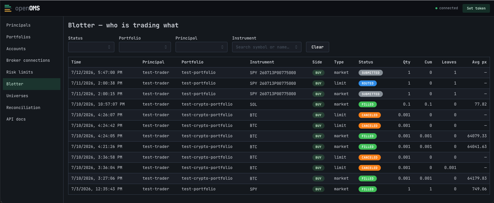
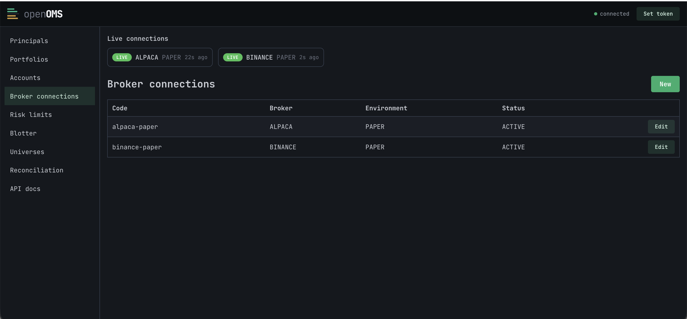

# OpenOMS

<p align="center">
  
</p>
<p align="center">
  <a href="https://github.com/maxkuttner/openoms/actions/workflows/build.yml">
    
  </a>
</p>

*An* open source multi-client order management system.




---

## Install

```sh
curl -fsSL https://maxkuttner.github.io/openoms/install.sh | sh
oms init     # asks for your Postgres 16, writes ~/.config/oms/oms.toml, creates the database
oms          # starts the OMS on localhost:3001
```

Then open <http://localhost:3001/cockpit/>. Prebuilt binaries cover macOS (Apple
Silicon) and Linux (x86_64, OpenSSL 3).

## Documentation

**[maxkuttner.github.io/openoms](https://maxkuttner.github.io/openoms/)**

- [Installation](https://maxkuttner.github.io/openoms/getting-started/installation/) and [first run](https://maxkuttner.github.io/openoms/getting-started/first-run/)
- [Your first paper trade](https://maxkuttner.github.io/openoms/getting-started/first-paper-trade/) — Alpaca paper, end to end
- [Your first API call](https://maxkuttner.github.io/openoms/getting-started/first-api-call/) — curl and the Python client
- [Configuration](https://maxkuttner.github.io/openoms/configuration/reference/) — `oms.toml`, environment variables, [login (OIDC)](https://maxkuttner.github.io/openoms/configuration/login/)
- [Integrations](https://maxkuttner.github.io/openoms/integrations/alpaca/) — Alpaca, Binance, IBKR, Bybit, Databento
- [Operations](https://maxkuttner.github.io/openoms/operations/updating/) — updating, running as a service, database, backups, [troubleshooting](https://maxkuttner.github.io/openoms/operations/troubleshooting/)
- [API reference](https://maxkuttner.github.io/openoms/api/)

## Develop

```sh
git clone git@github.com:maxkuttner/openoms.git && cd openoms
docker compose up -d                          # a local Postgres 16
(cd cockpit && npm ci && npm run build)       # the cockpit bundle the binary embeds
cargo run -- init                             # press Enter through the prompts; password `postgres`
cargo run                                     # the OMS on localhost:3001
```

Needs Rust (stable), cmake and a C++ compiler (the embedded FIX engine), OpenSSL 3
(`brew install openssl@3` on macOS) and Node 22. For the cockpit with hot reload:
`cd cockpit && npm run dev` (localhost:5173).

The documentation site lives in [`docs-site/`](docs-site/) (Starlight):
`cd docs-site && npm ci && npm run dev`.
